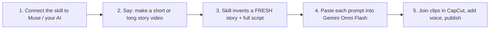

# Kid Papercraft Story Studio — v2

> **v2 upgrade:** real STORY (kahini) in every script, realistic TALKING characters, and a pro editing system. See `CHANGELOG.md` and the new docs: `SCRIPT_WRITING.md`, `TALKING_CHARACTERS.md`, `EDITING_GUIDE.md`, `SAMPLE_STORY_SCRIPT.md`.

### Create a magical origami stop-motion story video for kids — a brand-new adventure, funny moment and gentle lesson every single time, starring beloved animation heroes.


**Kid Papercraft Story Studio** is an AI Skill for Muse and other AI assistants. Connect it once, then ask for a video — and it invents a **fresh, never-repeated kids' story** for you: a complete simple-English script with dialogue and subtitles, plus ready-to-paste **Gemini Omni Flash** prompts for every 10-second clip, in the warm origami papercraft stop-motion style.

> This project began as a birthday-only generator. **That is no longer its purpose.**
> Birthday is now just one optional theme out of 30+. The real purpose is
> **daily story videos children love to watch again and again.**

Built for: kids' YouTube channels, YouTube Shorts / TikTok / Reels creators, parents, teachers, and family story time.

---

## What Changed vs. the Original Kid Papercraft

| Area | Original | Story Studio (this version) |
|------|----------|------------------------------|
| Purpose | Birthday greetings only | **Any kids' story, any day** |
| Story | Same 3-act birthday plot every time | **Story Engine: a different story every time** |
| Length | 30 seconds only | **Short 30s / 60s AND Long 3 / 5 / 8 min episodes** |
| Script | Birthday wishes + habit reminders | **Full story scripts: hook, problem, funny setback, teamwork, payoff, lesson** |
| Dialogue | Chinese voice lines | **Simple English dialogue + subtitles (other languages on request)** |
| Name / Title / Description | Birthday-focused, mixed languages | **All English** |
| Muse connection | Generic skill file | **Master skill + dedicated Short and Long skills, with series/episode tracking** |

---

## Features

- **A Different Story Every Time** — the Story Engine combines story type, setting, problem, funny moment, lesson and ending (millions of combinations), and the skill is instructed to never repeat a used combination.
- **Same Beloved Heroes, Same Paper World** — SpongeBob, Peppa Pig, Ultraman, Paw Patrol and Doraemon, all as tactile origami paper characters.
- **Short + Long Formats** — punchy 30/60-second Shorts with a 2-second hook, and full 3/5/8-minute episodes with chapters, songs and audience questions.
- **Complete Scripts Kids Love** — funny adventures, rescue missions, gentle mysteries, treasure hunts, animal friends, space trips, cooking fun, bedtime tales and more — every story ends happy and kind.
- **Ready-to-Paste Video Prompts** — every clip prompt is locked to the papercraft style, so all clips look like one film.
- **Publishing Pack Included** — video title, thumbnail text, description, chapters and hashtags with every output.
- **Kid-Safe by Design** — ages 3-8, simple words, gentle conflict only, no violence, no scary scenes, no sad endings. See `docs/KID_SAFETY.md`.
- **Series Mode for Channels** — episode numbering and rotation, so a daily channel never posts the same story twice.

## Supported Animation Heroes

| # | IP | Lead Characters | Origami World |
|---|----|-----------------|---------------|
| 🧽 | **SpongeBob SquarePants** | SpongeBob & Patrick Star | Origami Bikini Bottom, pineapple house, paper coral reef |
| 🐷 | **Peppa Pig** | Peppa & George | Origami grassy hills, muddy paper puddles, picnic garden |
| ⭐ | **Ultraman** | Chibi heroic giant & a friendly small monster | Miniature origami city at sunset |
| 🐶 | **Paw Patrol** | Chase & Marshall | Origami rescue town and lookout |
| 🤖 | **Doraemon** | Doraemon & Nobita | Cozy origami bedroom full of magical paper gadgets |

## The Story Engine (How Every Story Stays Fresh)

Each story mixes one item from each list — change the mix, change the story:

- **20 story types:** funny adventure, rescue, friendship, gentle mystery, treasure hunt, helping a new friend, gadget trouble, animals, cooking, weather, space, under the sea, school, bedtime, festivals, sports, music, garden, travel — and birthday, occasionally.
- **16 paper settings:** beach, forest, market, school, farm, zoo, train, boat, rocket, castle, bakery, library, snow hill, rainbow bridge, treehouse, lighthouse.
- **10 gentle problems, 7+ funny moments, 14 gentle lessons, 6 happy endings.**

Full lists: `docs/STORY_BANK.md` — including **50 ready-to-use story ideas**.

## Example Stories (No Birthdays Needed)

- **SpongeBob — "The Lost Paper Kite"** (Short 60s): a bubble sneeze blows the kite away; a tiny paper crab and teamwork save the day. Lesson: helping each other.
- **Paw Patrol — "The Rainy Day Rescue Parade"** (Long 5 min): paper ducklings, a folded-flat bridge, and Marshall's umbrella-boat hat. Lesson: kindness to animals.
- **Doraemon — "The Giggling Gadget Picnic"**: a gadget makes paper sandwiches dance — until everyone learns to share them.

## Workflow



1. **Choose** Short (30/60s, 9:16) or Long (3/5/8 min, 16:9) — or just say "surprise me".
2. **Choose a hero** — or let the skill rotate heroes for you.
3. **Get the full pack** — story summary, dialogue script with subtitles, every clip prompt, thumbnail/title/description.
4. **Generate** each 10-second clip in Gemini Omni Flash.
5. **Edit & publish** — join in CapCut/Premiere, add the voice lines and happy music.

## Installation

### Muse / Gemini CLI / Codex / Antigravity

```bash
git clone <this-repository-url>
cd kid-papercraft-story-studio

# Master skill (story engine — start here)
cp -R skills/kid-papercraft ~/.gemini/config/skills/kid_papercraft_story_studio

# Add the dedicated format skills too
cp -R skills/kid-papercraft-short-video ~/.gemini/config/skills/
cp -R skills/kid-papercraft-long-video  ~/.gemini/config/skills/

# Codex: replace the target folder with "${CODEX_HOME:-$HOME/.codex}/skills/"
```

For **Muse**: add this repository / the `SKILL.md` files as a skill in your Muse setup, then simply chat:

```text
Make me a short papercraft story video for kids.
Make me a long Doraemon story video, 5 minutes.
Surprise me — a new story for today.
```

Every new request must produce a new story. If it ever repeats one, say
"give me a different story" and the skill will re-roll the Story Engine.

## Repository Structure

```
.
├── README.md                        # This file (English)
├── SKILL.md                         # Master skill — Story Engine + rules
├── skills/
│   ├── kid-papercraft/              # Master skill (installable copy)
│   ├── kid-papercraft-short-video/  # Short 30s / 60s skill
│   └── kid-papercraft-long-video/   # Long 3 / 5 / 8 min episode skill
├── docs/
│   ├── STORY_BANK.md                # Story Engine lists + 50 story ideas
│   ├── SCRIPT_WRITING.md            # v2 Story (kahini) first script bible
│   ├── TALKING_CHARACTERS.md        # v2 Realistic talking / lip-sync guide
│   ├── EDITING_GUIDE.md             # v2 Pro editing, sound, subtitles, export
│   ├── SAMPLE_STORY_SCRIPT.md       # v2 A complete script at the quality standard
│   └── KID_SAFETY.md                # Kid-safety checklist
├── CHANGELOG.md                     # What changed vs. the original
└── LICENSE                          # MIT
```

## Disclaimer & IP Notice

1. **Non-Affiliation:** This is an unofficial, fan-made open-source prompt skill. It is not affiliated with, sponsored by, or endorsed by any animation studio or trademark owner.
2. **Intellectual Property:** All characters, names and likenesses (including SpongeBob SquarePants, Peppa Pig, Ultraman, Paw Patrol and Doraemon) belong to their respective copyright and trademark owners.
3. **Use:** Intended for personal, family and educational creative use. If you publish or monetize videos using protected characters, you are responsible for complying with copyright law, the rights holders' policies, and each platform's terms of service.

## Contributing

New heroes, new story types, better prompts and new language dialogue packs are welcome — please open an issue or a pull request.

## License

[MIT License](LICENSE) — based on the original Kid Papercraft by kaomei (MIT). See `CHANGELOG.md` for attribution and the full list of changes.
